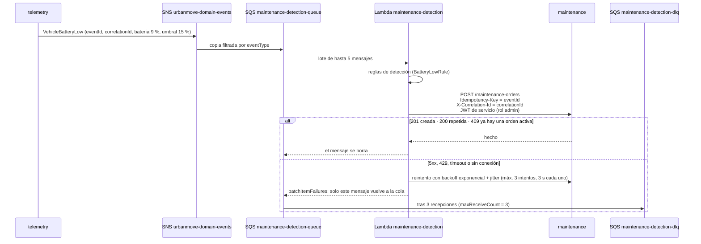

# Detección automática de mantenimiento (Lambda `maintenance-detection`)

Bloque B. Código en [`lambdas/maintenance-detection/`](../../lambdas/maintenance-detection).

Cuando telemetry detecta que un vehículo tiene poca batería, la Lambda abre sola la orden de mantenimiento. Sin ella, alguien tendría que ver la alerta y crear la orden a mano.

## Flujo



## Decisiones

| Tema | Decisión | Por qué |
|---|---|---|
| Idempotencia | El `eventId` del evento es la `Idempotency-Key` de la petición. | SQS entrega *al menos una vez*: el mismo evento puede llegar dos veces y maintenance devuelve la misma orden (200). Si el vehículo ya tiene otra orden activa, maintenance responde 409 `active-order-exists`, y la Lambda lo trata como "ya está hecho". |
| Reglas | Patrón Strategy: `DetectionRule`, con `BatteryLowRule` como primera regla y `DetectionRules` para combinarlas. | Las reglas de avería o de exceso de uso se añaden con una clase nueva, sin tocar el resto (OCP, `AGENTS.md` 5.4). |
| Fallos parciales | `ReportBatchItemFailures`: la Lambda devuelve solo los mensajes que fallaron. | Un mensaje malo no obliga a repetir todo el lote. |
| Tiempo | Antes de cada mensaje, la Lambda mira el tiempo que le queda. Si quedan menos de 15 s, devuelve el resto del lote sin tocarlo. | Si la Lambda se corta por timeout, AWS repite el lote entero. |
| Errores | 5xx, 429, timeout y sin conexión se reintentan dentro de la Lambda y después por SQS. 401/403 (token rechazado) van por SQS sin reintento inmediato. 400 y otros 4xx y los eventos mal formados acaban en la DLQ. | Lo que acaba en la DLQ se puede revisar y reprocesar (abajo). |
| Conexiones | El cliente HTTP, el token y el caso de uso se crean una vez por contenedor (`MaintenanceDetectionHandler.Shared`). | Se reutilizan entre invocaciones en caliente (*warm start*, `AGENTS.md` 5.1). No guardan estado de negocio. |
| Identidad | JWT HS256 firmado con `JWT_SECRET`: `sub = svc-maintenance-detection`, `roles = [admin]`, 15 min de validez. Es lo que pide `maintenance.yaml`. | **Provisional**: el formato de los tokens de servicio lo decide el bloque A (decisión abierta 2 de `docs/contracts/openapi/README.md`). Cambiarlo afecta solo a `ServiceTokenIssuer`. |

## Reprocesar la DLQ (escenario de fallo 2)

Si maintenance estuvo caído, los eventos de batería baja esperan en `maintenance-detection-dlq`. Cuando vuelve a funcionar, se devuelven a la cola y la Lambda los procesa. Gracias a la `Idempotency-Key`, uno que ya se hubiera procesado no crea otra orden.

```bash
# Local (LocalStack)
docker compose exec localstack awslocal sqs start-message-move-task \
  --source-arn arn:aws:sqs:us-east-1:000000000000:maintenance-detection-dlq \
  --destination-arn arn:aws:sqs:us-east-1:000000000000:maintenance-detection-queue

# AWS (cambia la cuenta)
aws sqs start-message-move-task \
  --source-arn arn:aws:sqs:us-east-1:<cuenta>:maintenance-detection-dlq \
  --destination-arn arn:aws:sqs:us-east-1:<cuenta>:maintenance-detection-queue
```

Probado en local: con maintenance parado, el evento acaba en la DLQ en unos 110 s. Tras arrancar maintenance y ejecutar el comando, la orden se crea.

## Despliegue

**Local:** `docker compose up` compila el `.jar` (servicio `lambda-build`). Después `infra/local/localstack/init-aws.sh` crea la función y la conecta a la cola. Los logs de la Lambda están en CloudWatch Logs de LocalStack:

```bash
docker compose exec localstack awslocal logs filter-log-events --log-group-name /aws/lambda/maintenance-detection
```

**AWS (Terraform, bloque D):**

- `aws_lambda_function` con `runtime = "java21"`, `handler = "com.urbanmove.maintenancedetection.interfaces.MaintenanceDetectionHandler::handleRequest"`, `memory_size = 256`, `timeout = 30` y `role = data.aws_iam_role.lab_role.arn` (no se puede crear un rol en AWS Academy).
- Variables `MAINTENANCE_URL` (URL de maintenance en ECS) y `JWT_SECRET` (desde una variable de Terraform, nunca escrita en el repositorio).
- `aws_lambda_event_source_mapping` desde `maintenance-detection-queue`, con `batch_size = 5` y `function_response_types = ["ReportBatchItemFailures"]`.
- La cola necesita `visibility_timeout_seconds >= 30` (el timeout de la función) y su redrive a `maintenance-detection-dlq` con `maxReceiveCount = 3`.

## Configuración

| Variable | Por defecto | Para qué |
|---|---|---|
| `MAINTENANCE_URL` | (obligatoria) | Base del servicio maintenance, p. ej. `http://maintenance:8080` |
| `JWT_SECRET` | (obligatoria) | Firma del JWT de servicio (mínimo 32 bytes) |
| `HTTP_TIMEOUT_MS` | 3000 | Timeout de cada llamada (máximo 3000, `AGENTS.md` 6.4) |
| `MAX_ATTEMPTS` | 3 | Intentos por mensaje dentro de una invocación |
| `SAFETY_MARGIN_MS` | 15000 | Tiempo mínimo que debe quedar para empezar un mensaje |
