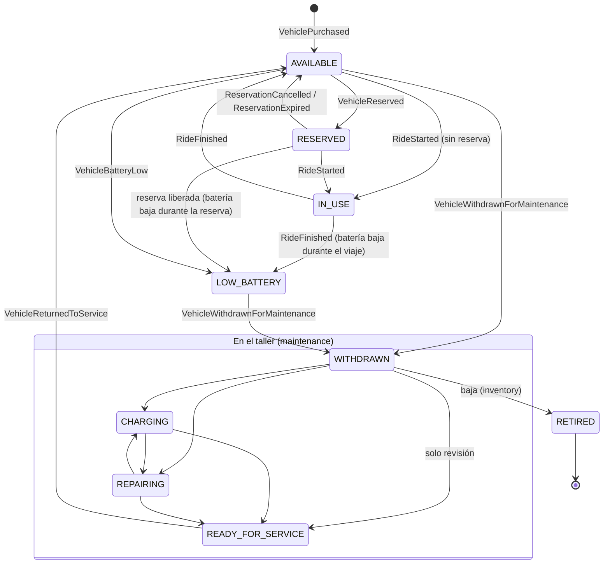
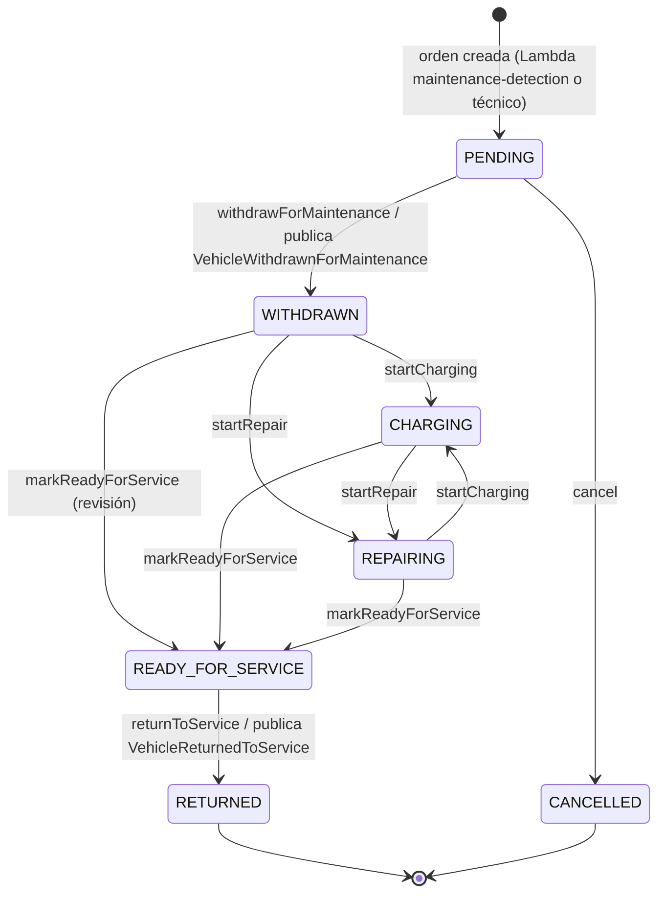

# Máquina de estados del vehículo

Responsable: **bloque B** (responsabilidad transversal). Estado: **BORRADOR, pendiente de revisión por el equipo.**

El enunciado (sección 5) pide documentar qué evento provoca cada cambio de estado del vehículo y qué servicio lo valida. Este documento es esa tabla. El código que la implementa está en:

- `services/availability/src/main/java/com/urbanmove/availability/domain/VehicleState.java`
- `services/maintenance/src/main/java/com/urbanmove/maintenance/domain/MaintenanceOrderState.java`

Los tests de cada servicio recorren **todas** las combinaciones (estado × acción) y comprueban que las de esta tabla funcionan y que el resto lanza `InvalidStateTransitionError` sin cambiar nada.

## Decisión: el estado se reparte entre tres dueños

El catálogo cerrado de 13 eventos no tiene ningún evento para `CHARGING`, `REPAIRING`, `READY_FOR_SERVICE` ni `RETIRED`. En lugar de inventar eventos, cada trozo del ciclo de vida tiene un único dueño:

| Estados | Dueño | Por qué |
|---|---|---|
| `AVAILABLE`, `RESERVED`, `IN_USE`, `LOW_BATTERY`, `WITHDRAWN` | **availability** | Es el estado operativo que ve el resto del sistema: lo que se puede reservar y dónde. Cambia con eventos del catálogo. |
| `CHARGING`, `REPAIRING`, `READY_FOR_SERVICE` | **maintenance** | Pasan dentro del taller. Son estados de la orden de mantenimiento. Para el resto del sistema el vehículo está `WITHDRAWN` hasta que llega `VehicleReturnedToService`. |
| `RETIRED` | **inventory** | Es una baja administrativa del activo. availability también lo refleja para no ofrecer el vehículo nunca más (ver decisión abierta 1). |

Así se usan los 9 estados oficiales, no se inventa ningún evento y cada servicio valida solo lo suyo (base de datos por servicio, ADR-001). Esta decisión es candidata al ADR del bloque B.

## Vista completa (los 9 estados)

## Tabla de transiciones: availability

`availability` no publica eventos: consume los de otros servicios y aplica la transición. Si la transición es ilegal, lanza `InvalidStateTransitionError`.

| Desde | Acción | Hasta | Evento que la provoca | Productor |
|---|---|---|---|---|
| — | registro | `AVAILABLE` | `VehiclePurchased` (zona `initialZoneId`) | acquisitions |
| `AVAILABLE` | `reserve` | `RESERVED` | `VehicleReserved` | reservations |
| `RESERVED` | `releaseReservation` | `AVAILABLE`, o `LOW_BATTERY` si hubo aviso de batería | `ReservationCancelled`, `ReservationExpired` | reservations |
| `AVAILABLE`, `RESERVED` | `startRide` | `IN_USE` | `RideStarted` | rides |
| `IN_USE` | `finishRide` | `AVAILABLE`, o `LOW_BATTERY` si hubo aviso; pasa a la zona de destino | `RideFinished` | rides |
| `AVAILABLE` | `reportLowBattery` | `LOW_BATTERY` | `VehicleBatteryLow` | telemetry |
| `RESERVED`, `IN_USE` | `reportLowBattery` | sin cambio; se anota y se aplica al liberarse | `VehicleBatteryLow` | telemetry |
| `LOW_BATTERY`, `WITHDRAWN`, `RETIRED` | `reportLowBattery` | sin cambio (la telemetría se repite) | `VehicleBatteryLow` | telemetry |
| `AVAILABLE`, `LOW_BATTERY` | `withdrawForMaintenance` | `WITHDRAWN` | `VehicleWithdrawnForMaintenance` | maintenance |
| `WITHDRAWN` | `returnToService` | `AVAILABLE` en la zona del evento; borra el aviso de batería | `VehicleReturnedToService` | maintenance |
| `AVAILABLE`, `LOW_BATTERY` | `relocate` | sin cambio de estado; cambia de zona | `RelocationOrderCompleted` | relocation |
| `WITHDRAWN` | `retire` | `RETIRED` | ninguno en el catálogo (decisión abierta 1) | inventory |

Todo lo demás es ilegal. Ejemplos importantes:

- `RESERVED` → `reserve`: **no se puede reservar dos veces** el mismo vehículo.
- `LOW_BATTERY` → `reserve`: un vehículo con batería baja no se ofrece.
- `IN_USE` / `RESERVED` → `withdrawForMaintenance`: no se retira un vehículo que alguien está usando o tiene reservado.
- `WITHDRAWN` → `reserve` / `startRide`: un vehículo en el taller no se usa.
- `RETIRED` → cualquier cosa salvo `reportLowBattery`: estado final.

## Tabla de transiciones: orden de mantenimiento

La orden tiene 7 estados. Cuatro coinciden con estados oficiales del vehículo (`WITHDRAWN`, `CHARGING`, `REPAIRING`, `READY_FOR_SERVICE`): mientras la orden está en uno de ellos, ese es el estado real del vehículo en el taller. Los otros tres son de la orden: `PENDING` (creada, vehículo aún en la calle), `RETURNED` y `CANCELLED`.

| Desde | Acción | Hasta | Efecto |
|---|---|---|---|
| — | `open` | `PENDING` | Orden creada con motivo (`LOW_BATTERY`, `BREAKDOWN`, `EXCESS_USAGE`, `INSPECTION`, `VANDALISM`) |
| `PENDING` | `withdrawForMaintenance` | `WITHDRAWN` | Se asigna el técnico y se publica **`VehicleWithdrawnForMaintenance`** |
| `PENDING` | `cancel` | `CANCELLED` | Orden duplicada o falsa alarma; no se publica nada |
| `WITHDRAWN`, `REPAIRING` | `startCharging` | `CHARGING` | Se anota el trabajo `RECHARGE` |
| `WITHDRAWN`, `CHARGING` | `startRepair` | `REPAIRING` | Se anota el trabajo `REPAIR` |
| `WITHDRAWN`, `CHARGING`, `REPAIRING` | `markReadyForService` | `READY_FOR_SERVICE` | Si no hubo carga ni reparación, se anota `INSPECTION` |
| `READY_FOR_SERVICE` | `returnToService` | `RETURNED` | Se publica **`VehicleReturnedToService`** con `workPerformed`, zona y `outOfServiceSeconds` (base del MTTR de `dm_maintenance`) |

Ilegales importantes: no se cancela una orden con el vehículo ya retirado, y no se devuelve a la calle sin pasar por `READY_FOR_SERVICE`.

## Cómo se combinan: flujo de mantenimiento (sección 11.2)

1. telemetry detecta batería baja y publica `VehicleBatteryLow` → availability pasa el vehículo a `LOW_BATTERY` (ya no se puede reservar).
2. La Lambda `maintenance-detection` consume el mismo evento y crea una orden `PENDING` en maintenance.
3. El técnico retira el vehículo desde la app de mantenimiento → orden `WITHDRAWN` → `VehicleWithdrawnForMaintenance` → availability pasa a `WITHDRAWN`.
4. En el taller: `CHARGING` / `REPAIRING` → `READY_FOR_SERVICE`. Solo cambia la orden; availability no se entera.
5. El técnico lo devuelve → orden `RETURNED` → `VehicleReturnedToService` → availability pasa a `AVAILABLE` en la zona indicada, y telemetry reinicia los contadores de uso.

## Decisiones abiertas (para revisar en grupo)

1. **`RETIRED` no tiene evento.** inventory da de baja el activo, pero ningún evento del catálogo se lo dice a availability. Opciones: (a) ampliar el catálogo con `VehicleRetired` (requiere aprobación de todos); (b) que availability lo deje en `WITHDRAWN` para siempre, que en la práctica tampoco se puede reservar. **Propuesta: (a)**, porque `dm_fleet` necesita contar los `RETIRED`.
2. **¿Quién evita la doble reserva?** La máquina de estados rechaza reservar un vehículo `RESERVED`, pero eso solo protege dentro de availability. Si reservations crea la reserva y availability se entera después por el evento, dos usuarios pueden reservar a la vez. Hay que acordarlo con el bloque A: o reservations pregunta a availability de forma síncrona con bloqueo optimista (`version`, AGENTS.md 5.5), o reservations mantiene su propia copia de disponibilidad.
3. **Eventos fuera de orden.** SQS no garantiza el orden: puede llegar `RideStarted` antes que `VehicleReserved`. Con la tabla actual, `AVAILABLE → startRide` es legal, así que funciona; pero un `VehicleReserved` que llega tarde sobre un vehículo `IN_USE` sería rechazado. El consumidor debe registrar el rechazo con el `correlationId` y hacer ACK (no reintentar), igual que con los duplicados.
4. **Vehículos nuevos.** Se asume que `VehiclePurchased` deja el vehículo `AVAILABLE` en su zona inicial. Si se quiere una revisión antes de la primera salida, entraría como `WITHDRAWN` con una orden de tipo `INSPECTION`.
